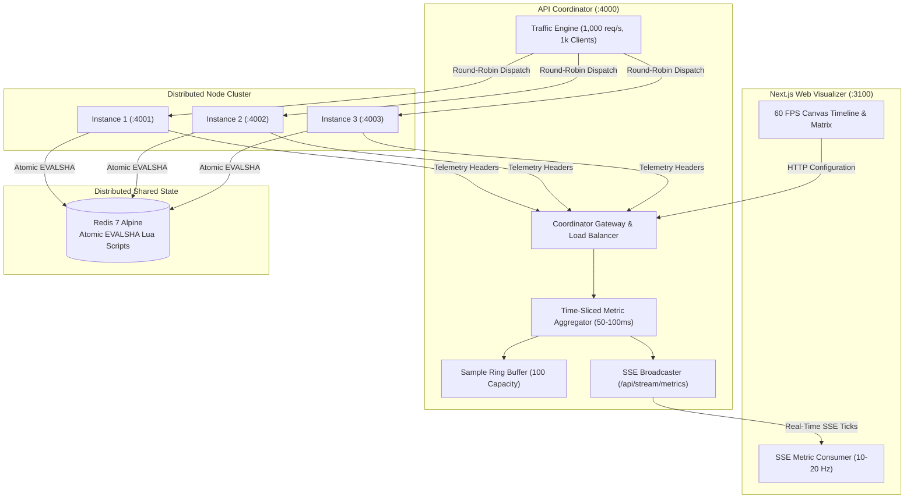

# throTl

> **Ultra-high performance simulator, 60 FPS live visualizer, and deterministic benchmark harness for distributed rate limiting.**

`throTl` is a distributed rate limiting engineering harness designed for high-resolution profiling, algorithmic verification, and cluster telemetry. It models both local in-memory algorithms and atomic distributed Redis Lua scripts under synthetic workloads up to 1,000 req/s across 1,000 virtual clients.

---

## 1. System Architecture



### Monorepo Structure

```
.
├── apps/
│   ├── api/                     # Coordinator, 3-node cluster, traffic generator, metrics
│   │   ├── src/
│   │   │   ├── coordinator/     # Load balancer (:4000) & SSE telemetry broadcaster
│   │   │   ├── instance.ts      # Cluster worker node (:4001, :4002, :4003)
│   │   │   ├── traffic/         # High-throughput synthetic traffic engine & presets
│   │   │   └── metrics/         # Ring buffer & time-sliced tick aggregator
│   │   └── test/
│   │       └── benchmarks/      # Automated invariant benchmark suite
│   └── web/                     # Next.js 15 visualizer & studio dashboard
│       ├── app/                 # Dashboard cockpit and comparison matrix routes
│       └── components/          # Canvas timeline, instance gauges, state inspector
├── packages/
│   └── rate-limiter/            # Unified rate limiter engine (In-Memory + Redis Lua)
│       ├── src/
│       │   ├── algorithms/      # 5 In-Memory algorithm implementations
│       │   ├── redis/           # 5 Atomic Redis Lua scripts & connection manager
│       │   └── types.ts         # Unified IRateLimiter interface
│       └── test/                # Unit test suites per algorithm
├── compose.yaml                 # Docker Compose with Redis 7 Alpine
├── turbo.json                   # Turborepo task pipeline
└── package.json                 # Monorepo root workspaces
```

---

## 2. Algorithm Matrix

All limiters adhere to the unified `IRateLimiter` contract, returning nanosecond-precision execution durations (`process.hrtime.bigint()`), remaining budget, reset timestamps, and internal state snapshots.

| Algorithm | In-Memory Engine | Redis Distributed Engine | Time Complexity | Memory Complexity | Burst Resilience | Traffic Smoothing |
| :--- | :--- | :--- | :--- | :--- | :--- | :--- |
| **Fixed Window** | `FixedWindowLimiter` | `RedisFixedWindowLimiter` | `O(1)` | `O(1)` | ❌ Leaks 200% at boundary | ❌ Burst-prone |
| **Sliding Log** | `SlidingLogLimiter` | `RedisSlidingLogLimiter` | `O(log N)` | `O(N)` | ✅ Strict protection | ❌ Unsmoothed |
| **Sliding Window Counter** | `SlidingWindowCounterLimiter` | `RedisSlidingWindowCounterLimiter` | `O(1)` | `O(1)` | ✅ Weighted estimation | ⚠️ Linearized |
| **Token Bucket** | `TokenBucketLimiter` | `RedisTokenBucketLimiter` | `O(1)` | `O(1)` | ✅ Strict burst capacity | ⚠️ Bursts allowed up to `C` |
| **Leaky Bucket** | `LeakyBucketLimiter` | `RedisLeakyBucketLimiter` | `O(1)` | `O(1)` | ✅ FIFO queue overflow drop | ✅ Strict constant rate leak |

---

## 3. Mathematical Verification Invariants

The automated benchmark suite (`apps/api/test/benchmarks/`) verifies three mathematical properties:

### 1. Boundary Burst Invariant
- **Scenario**: Limit 100 req/min. 100 requests arrive at `t=59.9s`, followed by 100 requests at `t=60.1s`.
- **Fixed Window**: Admits all **200 requests** within 200ms (100% boundary leak over-admission).
- **Sliding Window Counter**: Strictly admits **100 requests** (0 requests in Phase 2 via weighted previous-slice calculation).
- **Sliding Log**: Strictly admits **100 requests** (0 requests in Phase 2 via timestamp expiration).

```
====================================================================================
BENCHMARK 1: BOUNDARY BURST INVARIANT VERIFICATION REPORT
Traffic: 200 requests across boundary (100 @ t=59.9s, 100 @ t=60.1s | Window=60s, Limit=100)
------------------------------------------------------------------------------------
Algorithm               Phase 1 (t=59.9s)  Phase 2 (t=60.1s)  Total Admitted  Boundary Leak?
------------------------------------------------------------------------------------
Fixed Window            100                100                200             YES (+100 reqs / 200%)
Sliding Window Counter  100                0                  100             NO  (0 reqs / 100%)
Sliding Log             100                0                  100             NO  (0 reqs / 100%)
====================================================================================
```

### 2. Cluster Coordination Invariant
- **Scenario**: Limit 100 req/min. 300 requests distributed evenly across Instances 1, 2, and 3.
- **Per-Instance Mode**: Each instance enforces a local budget of 100, admitting **300 requests total** (300% cluster leakage).
- **Shared Mode (Redis Lua)**: Atomic Lua scripts synchronize state, admitting **exactly 100 requests** and rejecting 200 with HTTP 429.

```
====================================================================================
BENCHMARK 2: CLUSTER COORDINATION INVARIANT VERIFICATION REPORT
Traffic: 300 requests distributed evenly across 3 cluster worker instances (Limit: 100 req/min)
------------------------------------------------------------------------------------
Coordination Mode   Allowed (200 OK)  Blocked (429)  Inst-1 Dist  Inst-2 Dist  Inst-3 Dist  Leak Status
------------------------------------------------------------------------------------
Per-Instance (Mem)  300               0              100          100          100          LEAK (300% budget)
Shared (Redis Lua)  100               200            34/66        33/67        33/67        PROTECTED (Exact 100)
====================================================================================
```

### 3. Throughput & Precision Timing Invariant
- **In-Memory Decision Latency**: **0.12 µs (124 ns)** mean, **705,000+ req/sec** throughput across 1,000 virtual clients.
- **Redis Lua Decision Latency**: **0.35 ms (351 µs)** mean using atomic `EVALSHA`.
- **Aggregator Footprint**: Zero dropped ticks and bounded memory heap under continuous 1,000 req/s loads.

---

## 4. Architectural Decision Records (ADRs)

### ADR-001: Unified `IRateLimiter` Contract & Nanosecond Timing
- **Decision**: All rate limiters implement a single contract returning `allowed`, `remaining`, `resetTimeMs`, `decisionLatencyNs`, and `internalState`. Timing is measured strictly via `process.hrtime.bigint()`.
- **Rationale**: Eliminates floating-point inaccuracies from `Date.now()` or `performance.now()`, enabling microsecond profiling without clock drift.

### ADR-002: Atomic Redis Lua Execution (`EVALSHA`) with Automatic Cache Recovery
- **Decision**: Distributed rate limiting executes inside single-turn atomic Lua scripts in Redis. Scripts are loaded on boot and invoked via SHA1 hash (`EVALSHA`). If Redis restarts, scripts automatically reload on `NOSCRIPT`.
- **Rationale**: Eliminates multi-step race conditions (`GET` -> evaluate -> `SET`) under concurrent cluster traffic.

### ADR-003: Time-Sliced Metric Aggregator (50–100ms) with Ring Buffer Sampling
- **Decision**: Backend flushes pre-aggregated metric ticks (P50/P90/P99 latencies, instance distributions, allowed/rejected totals) over Server-Sent Events (SSE). Raw request streams are retained only in a bounded circular buffer (100 items).
- **Rationale**: Protects browser clients from DOM freeze and message buffer saturation during 1,000 req/s simulation runs.

### ADR-004: Industrial Studio Design System
- **Decision**: Frontend follows high-contrast industrial minimalism (inspired by two26.studio): carbon black surfaces (`#060608`), safety orange accents (`#FF5400`), corner crosshairs (`+`), and monospace typography.
- **Rationale**: Dense developer-focused data layout prioritizing telemetry readability and visual precision.

---

## 5. Quick Start & Standard Commands

### Prerequisites
- **Node.js**: `>= 22.0.0`
- **Docker**: For Redis 7 Alpine container

### Installation & Redis Startup
```bash
# Clone and install dependencies
git clone https://github.com/your-username/throTl.git
cd throTl
npm install

# Start Redis 7 container
docker compose up -d redis
```

### Running Development Mode
```bash
# Starts coordinator (:4000), 3 worker nodes (:4001, :4002, :4003), and Next.js visualizer (:3100)
npm run dev
```

Open [http://localhost:3100](http://localhost:3100) in your browser.

### Running Test & Benchmark Suites
```bash
# Run all unit and integration tests across the monorepo
npm test

# Run the core rate-limiter engine tests
npm test --workspace @throtl/rate-limiter

# Run the automated mathematical invariant benchmark suite
npm run test:benchmarks --workspace @throtl/api
```

### Production Build
```bash
# Compile TypeScript packages and build Next.js optimized assets
npm run build
```

---

## 6. License
MIT
